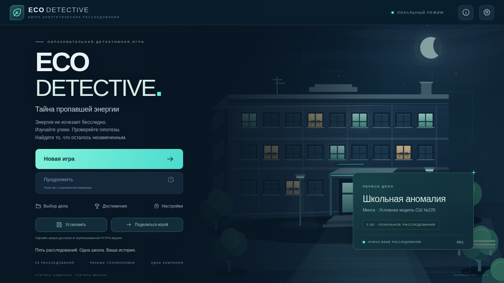
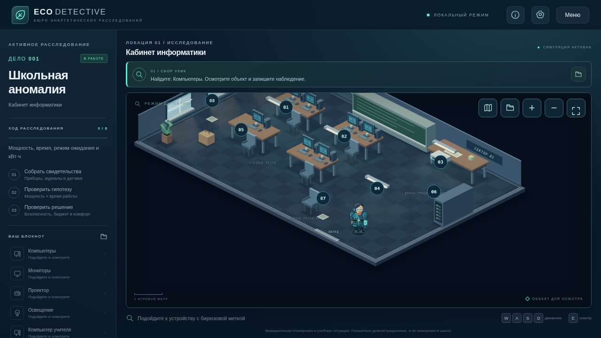
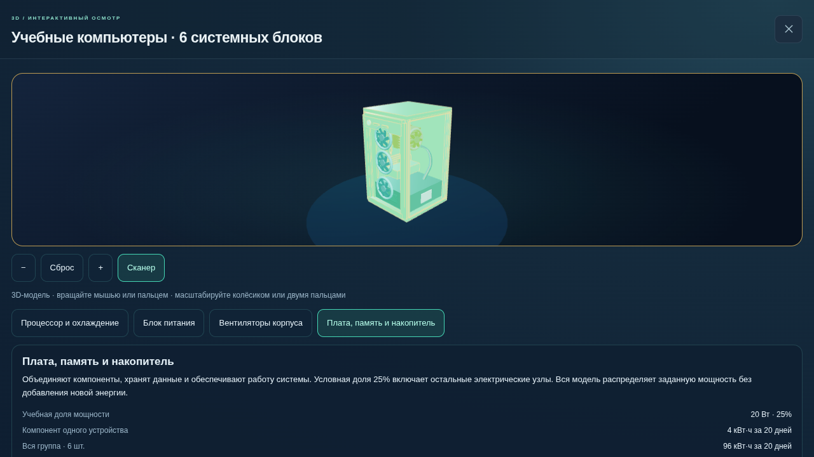
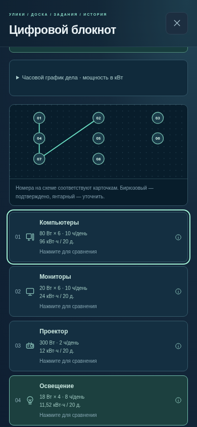

# ECO DETECTIVE: завершение текущего объёма модернизации

Дата: **11 октября 2026 года**. Ветка: `feature/eco-detective-3`. По последнему указанию пользователя завершены и проверены уже начатые изменения. Новые этапы не начинались. **Полное задание ECO DETECTIVE 3.0 пока не выполнено.**

`main` и публичный сайт остаются на выпуске 2.0 (`d9281e7`). Эта ветка содержит промежуточный вариант, который можно запустить локально. Не следует называть его опубликованной полной версией 3.0.

## 1. Реализованные изменения

- Сохранены существующие пять расследований, 39 источников, 15 вопросов анализа, гипотезы, проверка безопасных планов, отчёты и локальный прогресс.
- Добавлены диметрическая 2.5D-проекция, объёмная мебель, стены, окна, тени, свечение, новый детектив и следящая камера.
- Переработаны меню, HUD, карта дел, блокнот, паспорта оборудования и мобильные панели. Есть четыре режима качества, уменьшение анимаций, клавиатурное и сенсорное управление.
- Добавлен отдельный настоящий 3D-осмотр десяти типов объектов с вращением, приближением, выбором компонентов, сканером и сбросом ракурса.
- Завершена интерактивная доска для всех пяти дел: создание и удаление связей между записанными источниками, содержательная проверка, несколько цепочек, графики и три уровня локальных подсказок.
- Добавлены дополнительные цели и сохранение факта проверки другого безопасного плана. Повторное нажатие и перестановка полей сохранения не засчитываются как новое решение.
- Исправлен переход из завершённого сохранения первой версии к новому плану: игрок получает объяснение недостающих источников и доступ к анализу, прежнее завершение сохраняется.

## 2. Архитектура и основные файлы

| Область | Файлы |
| --- | --- |
| Проекция, камера и объёмная отрисовка | `src/rendering/projection.ts`, `src/rendering/isoCamera.ts`, `src/rendering/RoomRenderer.ts`, `src/game/RoomScene.ts` |
| Персонаж и взаимодействие | `src/game/Player.ts`, `src/game/InteractionSystem.ts` |
| Настоящий 3D-осмотр | `src/inspection/catalog.ts`, `models.ts`, `DeviceViewer.ts`, `Viewer.css` |
| Обновлённый интерфейс | `src/ui/GameUI.ts`, `NotebookPanels.ts`, `DeviceDetails.ts`, `v3Theme.css`, `public/images/menu-v3.svg` |
| Новая доска | **Новые:** `src/data/evidenceLinks.ts`, `src/systems/evidenceBoard.ts`, `src/ui/EvidenceBoard.ts`, `src/ui/EvidenceBoard.css` |
| Сравнение планов | **Новый:** `src/systems/planComparison.ts` |
| Совместимое дополнительное сохранение | `src/systems/v3Storage.ts` |
| Проверки новых правил | **Новые:** `tests/evidenceBoard.test.ts`, `tests/planComparison.test.ts` |

Phaser обслуживает игровую комнату, DOM — интерфейс, Three.js загружается отдельным модулем при 3D-осмотре. Расчёты не зависят от качества графики. Дополнительные данные хранятся в `eco-detective:extensions:v3`, отдельно от кампании v2 и исходного сохранения v1. Подготовленные поля будущих режимов в схеме сохранения **не означают**, что сами режимы реализованы.

## 3. Что сделано в 2.5D

Логические координаты движения, препятствий и доступности объектов сохраняются. Общая проекция переводит их в экранные координаты; обратное преобразование согласует направление клавиатуры и джойстика с видимым движением. Глубина зависит от положения объекта в комнате. У персонажа отдельное физическое тело и вертикальное изображение с опорой у ног.

Освещение и тени стилизованы. Они не являются физическим расчётом освещённости. Визуальные эффекты уже реагируют на часть режимов и планов, но ещё не управляются общей энергетической симуляцией. Полного набора анимаций окружения нет. Позиции `Interact`, `Inspect`, `Success` подготовлены в персонаже, но не все подключены к игровым событиям; регулярно используются движение, покой и сканирование.

## 4. Что действительно работает в 3D

Системный блок, монитор, проектор, светильник, холодильник, водяной радиатор, окно, сетевой узел, датчик и вентиляция построены из настоящей объёмной геометрии. Работают мышь, касания, pinch, ограничение приближения, выбор деталей, подсветка и возврат исходной камеры. Это оригинальные процедурные учебные модели, а не точные копии школьных приборов.

Для датчика и тепловых объектов электрическая мощность не выдумывается. Сводные источники финального дела не выдаются за самостоятельные физические устройства. При отсутствии WebGL показывается явно обозначенная схема. При закрытии прекращается отрисовка, освобождаются собственные ресурсы и теряется WebGL-контекст. Часть мощности компонентов — пояснительное распределение, не измерение.

## 5. Расследования и доска

Требуется соответственно **2 / 4 / 6 / 6 / 8 обязательных связей** в пяти делах. Игрок выбирает две карточки: соединение появляется на схеме и в доступном с клавиатуры списке. Произвольные пары не подтверждают цепочку. Неизвестные, повторные и неосмотренные источники фильтруются; неподтверждённую допустимую по форме пару можно прочитать и удалить.

Доска показывает фактические учебные характеристики записанного источника, расписания, исходные часовые графики и состояние гипотезы. Подсказки «ВАТТ» имеют три уровня и учитывают недостающие источники. Это **локальные подсказки доски**, а не законченный сопровождающий персонаж.

Доска остаётся дополнительной тренировкой: её результат не блокирует старые завершённые дела и не формирует автоматически сюжетную гипотезу. Свидетельств NPC пока нет. Выполнение цепочек, изучение 3D и альтернативные планы фиксируются однократно в дополнительном журнале, но ещё не связаны с новым каталогом XP, значков и косметических наград.

## 6. Энергосистема

Сохранена проверенная модель `E = P × t × количество / 1000`, расчёт за 20 учебных суток и исходные часовые графики мощности. Модель теплопередачи `Q = U × A × ΔT × t / 1000` рассматривается отдельно от электричества. 3D-паспорта и доска используют общий модуль расчёта электрической энергии.

**Нового живого симулятора ещё нет:** отсутствуют единый физический реестр всех устройств, управляемые виртуальные часы, события погоды, сквозные расписания и общий пересчитываемый баланс состояний школы. Сюжетные расчёты и ограничения работают, но не заменяют эту систему. Отдельного нового физического закона в текущей модернизации не добавлено.

## 7. Мобильная версия и изображения

Проверялись размеры от 320 × 568 до 1920 × 1080, включая портрет, горизонталь и планшет. Камера следует за персонажем; панели прокручиваются, джойстик сбрасывается при потере фокуса и отмене касания. В доске на узком экране карточки идут в один столбец, область нажатия удаления связи не меньше 44 px. Перерисовка доски сохраняет прокрутку.

Снимки меню, комнаты и 3D относятся к проверенным предыдущим этапам этой ветки; снимок доски — к текущей завершающей проверке:

| Меню | 2.5D-комната |
| --- | --- |
|  |  |

| Настоящий 3D-осмотр | Мобильная доска |
| --- | --- |
|  |  |

## 8. Проверки текущего результата

- `npm ci` — зависимости установлены.
- `npm run typecheck` — успешно.
- `npm test` — **148 тестов, 19 наборов, 0 ошибок**.
- `npm run build` и `npm run build:pages` — успешно. Vite предупреждает о крупных чанках; это остаётся задачей оптимизации загрузки, не ошибкой сборки.
- Chromium / Playwright: доска всех пяти дел на **1280 × 800, 320 × 568, 390 × 844**; создание, проверка, удаление, три подсказки, SVG и список, клавиатура, фокус, сохранение и повторная загрузка. Отдельно проверены поддельные и неосмотренные источники. **16 сценариев прошли без ошибок браузера.**
- Проверены другой безопасный план, небезопасный и недостаточный планы, повторная отправка, перестановка полей/действий и несущественный флаг дневного света: ложного дополнительного результата нет.
- Проверен перенос завершённого v1: старый результат и следующее доступное дело сохраняются, недостающие данные объясняются, новый анализ становится доступен после записи источников. Часть фикстуры подготовлена через API кампании; это проверка совместимости, не заявление о ручном прохождении.
- Первое дело заново пройдено на 390 × 844 реальными сенсорными событиями: перемещение к восьми источникам без телепортации, анализ, ошибочные и верные ответы, проверка и принятие плана. Итог — 151,88 → 50,12 кВт·ч за 20 учебных дней, без ошибок браузера.
- Текущая Pages-сборка проверена через настоящий service worker под `/eco-detective/`: первый запуск 3D после отключения сети, вращение настоящей модели, повторная офлайн-перезагрузка, сохранение пяти старых результатов и отсутствие повторной отметки за осмотр. Ошибок JavaScript, ответов 404 и неудачных запросов нет.

Подробные предыдущие проверки 39 источников, камеры, десяти 3D-моделей, очистки ресурсов и PWA описаны в [журнале этапов](PHASES_V3.md). Физические Android/iPhone, Safari, Firefox и Edge здесь не испытаны. Целевые 30/60 FPS на реальных устройствах не подтверждены; WebGL проверялся в Chromium с программным SwiftShader.

## 9. Что не выполнено из исходного задания

| Пункты задания | Незавершённая часть |
| --- | --- |
| §3–4 | Полный набор анимаций окружения, открывание дверей, подключение всех шести состояний детектива и всех эффектов событий |
| §7, фаза 6 | Центральный холл, физические двери и переходы, дополнительные связанные помещения, восстановление позиции по комнатам, свободное исследование |
| §8, фаза 7 | Единый реестр оборудования, виртуальное время, состояния/расписания, живой баланс по комнатам и категориям, согласованная реакция всего мира |
| §9–10 | Свидетельства NPC на доске; полноценный анимированный ВАТТ с обучением управлению, сопровождением всех этапов и объяснением ошибок вне доски |
| §11 | Генератор расследований по seed, три сложности, проверка разрешимости и повторяемости |
| §12 | Динамические события: погода, изменение расписания, мероприятия, неисправности датчиков и их реальные последствия в модели |
| §13 | Полная модернизация всех требований уровней: в частности, финал по нескольким связанным помещениям, динамические события и общая симуляция |
| §14 | Пять NPC, портреты, диалоги с выбором, пропуском, повторным просмотром и проверяемыми свидетельствами |
| §15 | Более глубокая интерактивная временная шкала/поиск аномалий и новая система последствий ошибок; существующие головоломки и образовательная обратная связь сохранены |
| §16 | Новые точные названия семи званий, расширенный каталог достижений, XP за новые цели, косметические награды и материалы |
| §17 | Пункты меню для ещё не созданных режимов, общая карта помещений и панели живого симулятора |
| §19 | Самостоятельная энергетическая лаборатория с произвольными приборами и экспериментами; нынешняя «Лаборатория решений» относится только к сюжетным планам |
| §20 | «Моя школа»: редактор помещений/приборов, собственные задачи, импорт и экспорт JSON |
| §21 | Безопасные домашние задания с ручным самоотчётом |
| §22 | Атмосфера помещений, полный набор звуков и независимые регуляторы громкости; сейчас есть базовые локальные сигналы и выключатель звука |
| §23 | Новый профиль со статистикой лучших результатов, полноценный повтор кампании с сохранением прошлых достижений и архивом прохождений; мини-карта единой школы |
| §24–25, §29 | Итоговые замеры производительности на целевых телефонах, полная межбраузерная и пользовательская проверка удобства |
| §26–27 | Модули и сохранение ещё не созданных режимов; подготовленная схема не заменяет реализацию |
| §28, фаза 9 | Публикация этой ветки, проверка обновления публичной PWA до окончательного выпуска и итоговая регрессия всех новых режимов |
| §32–36 | Полный конкурсный комплект окончательной 3.0, защита всех новых алгоритмов, полный финальный отчёт о выполнении всех критериев. Этот документ описывает только фактический промежуточный результат |

Все изображения, планировки, характеристики и проблемы — вымышленные учебные сценарии. Они не подтверждают реальные нарушения или измеренную экономию в СШ №225.

## 10. Запуск и следующий этап

```sh
git switch feature/eco-detective-3
npm ci
npm run dev
```

Откройте адрес Vite. Для телефона в той же Wi-Fi-сети используйте сетевой адрес компьютера из вывода Vite. Постоянный доступ из интернета требует отдельной публикации этой ветки. [Основная инструкция](../README.md) описывает сборку и Pages.

Если разработка будет продолжена, следующий шаг по исходному порядку — единая школа с холлом и безопасными переходами; затем общая энергетическая симуляция, дополнительные режимы и итоговый выпуск. Сейчас эти этапы не начаты.
